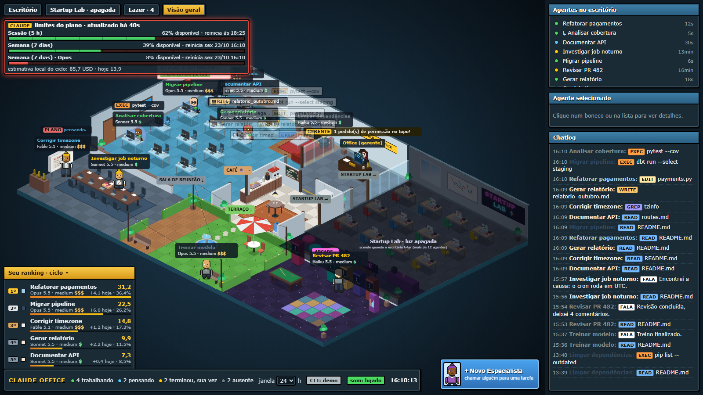
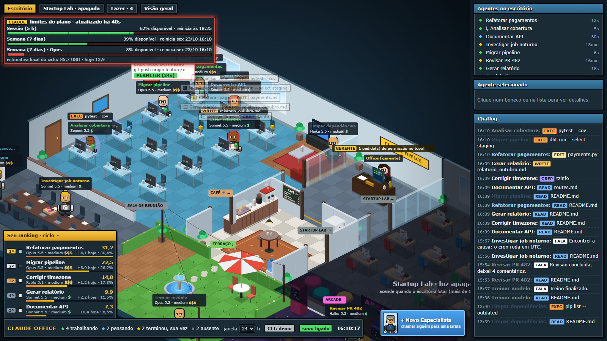
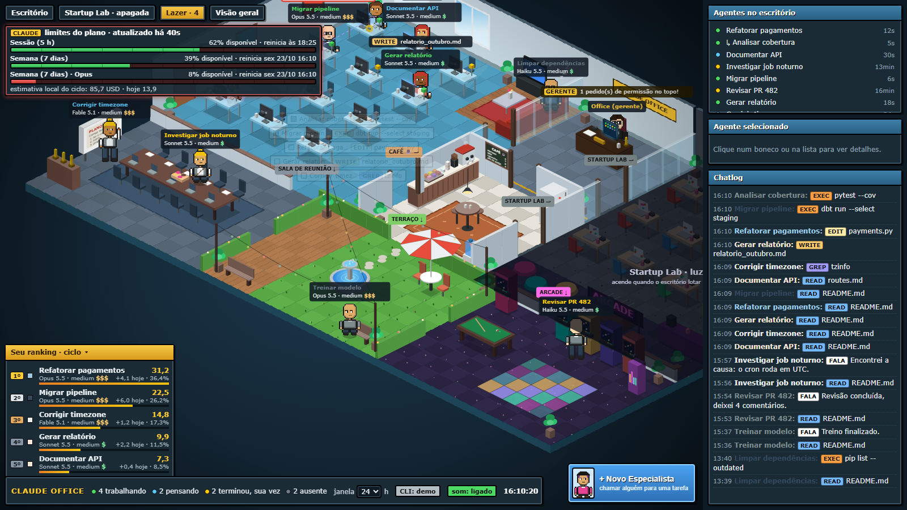
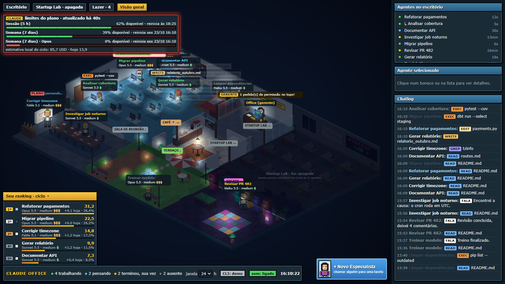

# Claude Office



Um escritório isométrico em pixel-art, no estilo Habbo Hotel, que mostra **ao vivo** o que as suas sessões do **Claude Code** estão fazendo nesta máquina. Cada sessão vira um bonequinho numa mesa: ele digita quando trabalha, pensa, toma café quando fica ocioso, cochila, chama subagentes como "reforços" e levanta a mão quando precisa de permissão — que você aprova com um clique. A página também cria sessões novas e envia comandos (com imagens coladas) para sessões existentes pelo CLI `claude`.

Tudo roda local: o servidor escuta só em `127.0.0.1`, lê as transcrições do Claude Code **somente leitura** e não envia nada para fora.

## Galeria

| Escritório | Lazer: reunião, terraço e arcade |
|---|---|
|  |  |
| **À noite** | |
|  | Capturas do modo demo (`python server.py --demo`), com dados fictícios. Para abrir direto numa aba use `?sala=escritorio`, `lab`, `lazer` ou `geral`; para ver outro horário, `?hora=22`. |

## Requisitos

- **Claude Code** instalado e logado (`claude auth status`). Serve o instalador nativo, o npm ou a cópia que vem com o app desktop (o escritório procura nos três lugares).
- **Python 3.11+** (só biblioteca padrão).
- Um navegador moderno.
- **Node 18+** apenas para rodar os testes do frontend.

## Como usar

```bat
run.bat
```

Abre `http://127.0.0.1:8777` e sobe o servidor. Alternativas:

```bat
python server.py --demo                       :: dados fictícios, sem tocar no ~/.claude
python server.py --projects D:\outra\pasta    :: outra pasta de projetos do Claude Code
python server.py --port 8780
```

A pasta lida é, nesta ordem: `--projects`, `CLAUDE_OFFICE_PROJECTS`, `CLAUDE_CONFIG_DIR\projects` e `~\.claude\projects`. O endereço `/api/health` mostra o que foi encontrado.

Copie `office.config.example.json` para `office.config.json` e ajuste `workspace_roots` (as pastas onde o escritório pode criar sessões), `models` e, se quiser, `claude_bin`. Esse arquivo não vai para o git.

## O que cada coisa na tela significa

| Elemento | Significado |
|---|---|
| Boneco digitando na mesa (verde) | sessão **trabalhando**: o último registro é uma chamada de ferramenta |
| Boneco parado na mesa (azul) | **pensando**: recebeu mensagem ou resultado de ferramenta e o modelo está respondendo |
| Amarelo, cochilando / no café | **terminou, sua vez**: respondeu e espera você. Ciclo de 10 min cochilando e 5 min de café |
| Cinza, no sofá ou em pé na sala do gerente | **ausente**: mais de 15 min sem atividade. Depois de 2 h parado vai para o sofá |
| Boneco menor com aura lilás e linha tracejada | **subagente** (Task/Agent), ligado ao pai. Senta na mesa livre mais próxima do pai ou trabalha em pé ao lado dele |
| "entreguei o resultado" | subagente concluído; some depois de 2 min |
| Balão branco com borda vermelha | **pedido de permissão**. Clique em PERMITIR (ou no painel) |
| Placa com `$` a `$$$$` | custo relativo: família do modelo, esforço (`effort`) e custo médio real por sessão |
| Gerente "Office" | narra o escritório e, quando chega comando para alguém ocioso, **liga para a mesa** dele: o telefone toca ("♪ RIIIM ♪") e o boneco atende ou volta correndo |
| Lazer (aba "Lazer") | faixa na frente do prédio, estilo Habbo: **sala de reunião** (mesa longa, projetor, troféus), **terraço** (fonte, guarda-sol, bancos, varal de luzes) e **arcade** (fliperamas, sinuca, jukebox, pista de dança) |
| Reunião de planejamento | sessão em **modo plano** (`permissionMode: plan`, inclusive o "Sim, quero um plano" do escritório) vai para a sala de reunião: o primeiro apresenta no telão, que mostra "PLANO" e a ação atual; os outros em plano e os subagentes deles sentam à mesa. Esperando aprovação, o balão mostra "plano pronto, aguardando aprovação". Ao sair do modo plano, volta para a mesa, que fica reservada |
| Ciclo de ócio | a cada 20 min: cochila na mesa, toma café e depois passeia pelo lazer. Com mais de 2 h parado vai para o sofá |
| Personagens | cada boneco ganha um arquétipo de escritório (o fazendeiro de beterraba, o rei das pegadinhas, a contadora dos gatos…) com visual e falas próprias |
| Efeitos | confete quando alguém termina, faíscas quando nasce um subagente, "zzz" de quem cochila, poeira nos feixes de luz e anel pulsante no selecionado |
| Startup Lab | anexo que acende quando o escritório lota (mais de 12 sessões) |
| Céu nas janelas / escuridão | segue a hora do computador: dia, entardecer (17h30–19h) e noite. À noite só ficam acesas as telas dos computadores ocupados e poucas luzes. Para testar: `http://127.0.0.1:8777/?hora=22` |
| Barra de vida (topo) | quanto resta dos limites do plano Claude (sessão de 5 h e semana), com o horário de reinício |

**Dica:** dê nomes às sessões com `/rename` (ou `claude -n "nome"`). Os nomes dados pela página têm prioridade, depois `custom-title`, o título gerado pela IA e, por último, o começo da primeira mensagem.

## Aprovar permissões pelo escritório

1. Rode `scripts\install_hook.bat`. Ele copia `hooks\office_permission.py` para `~\.claude\hooks\` e registra o hook `PermissionRequest` em `~\.claude\settings.json`, preservando os outros hooks.
2. **Abra uma sessão nova** do Claude Code. As que já estavam abertas não carregam o hook.
3. Quando uma ação pedir permissão, o balão aparece no boneco e você tem **40 s** para clicar em PERMITIR. Sem resposta, ou com "Decidir no app", o Claude Code segue o fluxo normal e pergunta no terminal (em `claude -p` a ação é negada).

O hook **nunca nega** nada, e suas regras `deny`/`ask` do Claude Code continuam valendo. Se o escritório estiver fechado, o hook sai na hora, sem atrasar o terminal. Para remover: `scripts\install_hook.bat -Uninstall`. Cada passo fica registrado em `%TEMP%\claude-office\office_permission.log`.

O hook só vê as sessões **desta máquina e deste usuário do Windows**.

## Barra de vida: limites do plano Claude

A barra do topo mostra os medidores que o próprio Claude informa para a sua assinatura (Pro, Max ou Team): a **sessão de 5 h**, a **semana** e, quando existir, o limite semanal por modelo. Cada medidor mostra quanto está disponível e quando reinicia. O Claude não tem limite diário: o que existe é a janela de 5 h e a semana.

Os números vêm do CLI. A cada 3 minutos o servidor roda `/usage` em segundo plano. É um comando local: não chama o modelo, não gasta cota e não grava sessão. Clique na barra para atualizar na hora. Para isso o **CLI do Claude Code precisa estar instalado e logado** com a sua conta claude.ai:

```powershell
irm https://claude.ai/install.ps1 | iex
claude auth login
```

Sem o CLI conectado, a barra explica o que falta. Embaixo dela fica uma estimativa local em USD (tokens de `message.usage` × tabela `prices` do `office.config.json`, deduplicados por `message.id`). Ela também alimenta o ranking. Os preços do exemplo seguem a tabela da API da Anthropic de 2026-10-06; confira os valores.

## Ranking

O canto inferior esquerdo mostra as 5 sessões que mais gastaram no ciclo, com o gasto de hoje e a fatia do total. Clique para selecionar. O título recolhe o painel.

## Criar sessões e enviar comandos

- **+ Novo Especialista**: escolha a pasta (dentro de `workspace_roots`), o nome, o modelo e a primeira mensagem (Ctrl+V cola imagens). O rosto no botão é o do próximo boneco: ele entra pela porta com essa aparência.
- **Enviar comando**: selecione um agente, escreva no painel e use Ctrl+Enter. Você pode trocar o modelo e colar ou arrastar imagens (até 5, de 5 MB cada).
- Antes de enviar, o escritório pergunta **"Quer um plano antes?"**. "Sim" usa `--permission-mode plan` quando o CLI tem esse modo; senão, prefixa um pedido de plano que pede para o agente parar antes de agir.
- Cada sessão roda **um comando por vez** (até 1 h). O botão Cancelar encerra o processo.
- O **selo CLI** na barra de baixo mostra o login. Vermelho abre o `claude auth login` num console próprio, e a página confere a cada 3 s.

Os comandos usam `claude -p` (sem janela). Se a sessão estiver aberta num terminal interativo, o histórico pode se misturar, então feche-a antes. Sessões abertas no terminal também não mostram em tempo real os comandos enviados pela página.

## Como funciona

```
 ~/.claude/projects/<slug>/<sessão>.jsonl ──┐   (somente leitura, incremental, cache por tamanho/mtime)
 .../<sessão>/subagents/agent-*.jsonl ──────┤
                                            ▼
                                     office.py ── usage.py (ciclo, ranking, custo)
                                            │
  hook PermissionRequest ─► %TEMP%\claude-office\pending\*.json ◄─ permissions.py
                                            │
  claude -p / auth ◄──────────── cli_bridge.py
                                            │
                              server.py (127.0.0.1, token + origem)
                                            │  /api/state a cada 2 s
                                            ▼
                         static/index.html + office.js + sprites.js (canvas 2D)
```

Os POSTs exigem `Host`/`Origin` local e o cabeçalho `X-Office-Token`, um token aleatório gerado a cada execução. Tokens e senhas são mascarados em tudo que é exibido.

## Testes

```bat
python -m pip install -r requirements-dev.txt
python -m pytest
python -m ruff check .
node tests\check_sprites.js
node tests\smoke_office.js
node tests\smoke_routes.js
node tests\smoke_wake.js
```

Teste manual do fluxo de permissão, com o servidor rodando: `python tests\e2e_permission.py`.

## Solução de problemas

- **Escritório vazio**: a caixa amarela mostra a pasta lida, o total de sessões e a última atividade. Aumente a janela (2/8/24/72 h) ou aponte `--projects`.
- **"offline: …" no relógio**: o servidor parou ou a porta mudou.
- **O balão de permissão não aparece**: instale o hook, abra uma sessão **nova** e confira `office_permission.log`. O escritório precisa estar aberto no navegador.
- **CLI: conectar / expirado**: clique no selo para fazer login. Se o `claude` não for encontrado, defina `claude_bin` no `office.config.json` ou a variável `CLAUDE_BIN`.

## Privacidade

Nada sai da máquina. O servidor só lê `~/.claude/projects`, mascara segredos e escuta em `127.0.0.1`. Imagens coladas ficam em `%TEMP%\claude-office-images` e são apagadas depois de 7 dias.

## Limitações

- Até 24 mesas (12 no Escritório + 12 no Startup Lab); a janela mostra no máximo 24 sessões.
- Só as sessões desta máquina e deste usuário do Windows.
- Sessões abertas no terminal não mostram em tempo real os comandos enviados pela página.
- O custo em USD é uma estimativa; os limites da assinatura não são legíveis automaticamente.
