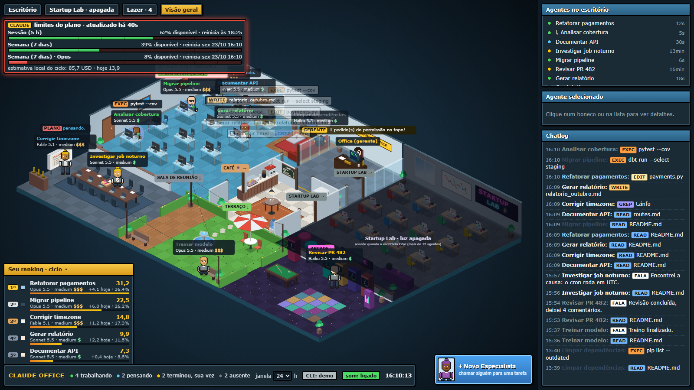
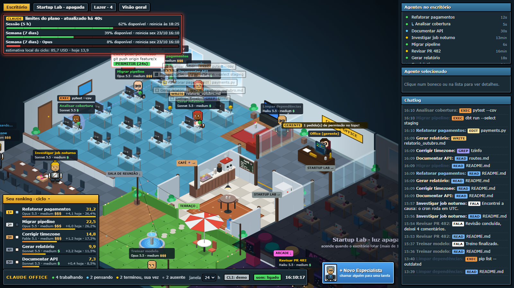
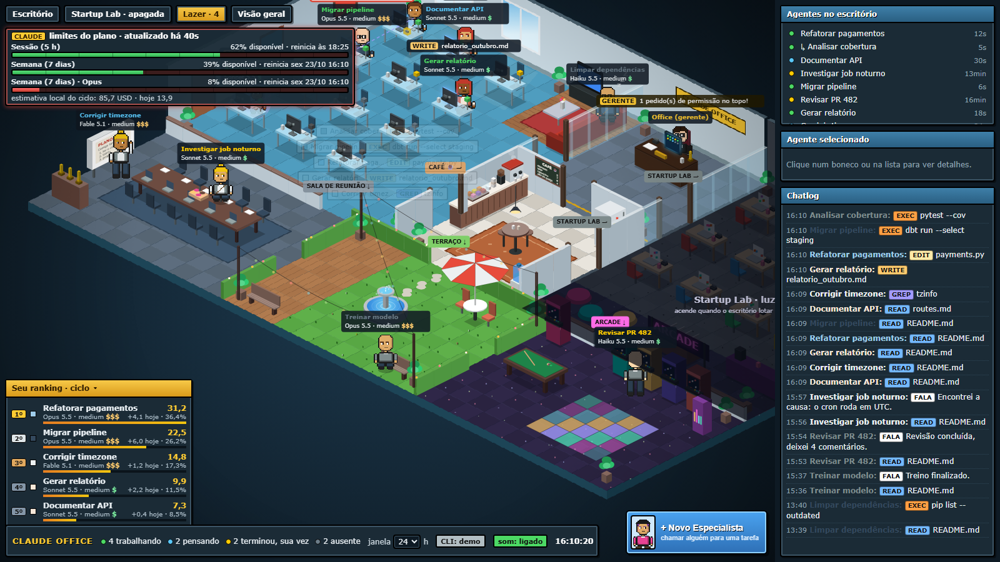
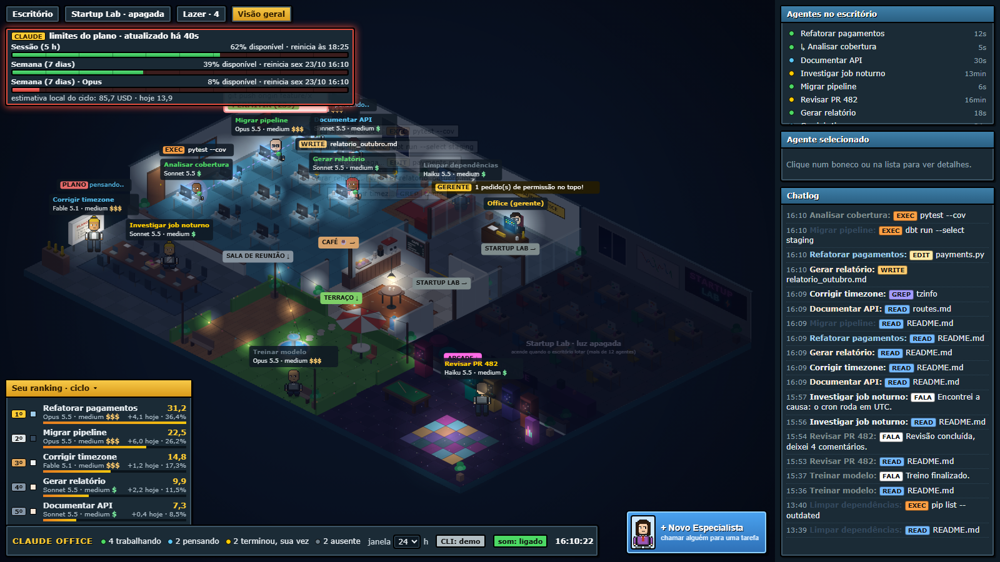

# Claude Office



Um escritório isométrico em pixel-art, no estilo Habbo Hotel, que mostra **ao vivo** o que as suas sessões do **Claude Code** estão fazendo nesta máquina. Cada sessão vira um bonequinho numa mesa: ele digita quando trabalha, pensa, toma café quando fica ocioso, cochila, chama subagentes como "reforços" e levanta a mão quando precisa de permissão — que você aprova com um clique. A página também cria sessões novas e envia comandos (com imagens coladas) para sessões existentes pelo CLI `claude`.

Tudo roda local: o servidor escuta só em `127.0.0.1`, lê as transcrições do Claude Code **somente leitura** e não envia nada para fora.

## Galeria

| Escritório | Lazer: reunião, terraço e arcade |
|---|---|
|  |  |
| **À noite** | |
|  | Capturas do modo demo (`python server.py --demo`), com dados fictícios. Para abrir direto numa aba use `?sala=escritorio`, `lab`, `lazer` ou `geral`; para ver outro horário, `?hora=22`. |

## Requisitos

- **Claude Code** instalado e logado (`claude auth status`). Serve o instalador nativo, o npm ou a cópia que vem com o app desktop (o escritório procura nos três lugares).
- **Python 3.11+** (só biblioteca padrão).
- Um navegador moderno.
- **Node 18+** apenas para rodar os testes do frontend.

## Como usar

```bat
run.bat
```

Sobe o servidor e abre `http://127.0.0.1:8777` no navegador assim que ele estiver pronto. Se o escritório já estiver rodando, só abre a página.

**Atalho na área de trabalho** (com o ícone do gerente):

```powershell
powershell -ExecutionPolicy Bypass -File scripts\create_shortcut.ps1
```

O atalho abre o servidor numa janela minimizada; fechar essa janela encerra o escritório. O ícone é gerado por `python scripts/make_icon.py` (`static/icon.ico` e `static/icon.png`, que também é o favicon).

Alternativas:

```bat
python server.py --demo                       :: dados fictícios, sem tocar no ~/.claude
python server.py --projects D:\outra\pasta    :: outra pasta de projetos do Claude Code
python server.py --port 8780
```

A pasta lida é, nesta ordem: `--projects`, `CLAUDE_OFFICE_PROJECTS`, `CLAUDE_CONFIG_DIR\projects` e `~\.claude\projects`. O endereço `/api/health` mostra o que foi encontrado.

Copie `office.config.example.json` para `office.config.json` e ajuste `workspace_roots` (as pastas onde o escritório pode criar sessões), `models` e, se quiser, `claude_bin`. Esse arquivo não vai para o git.

## O que cada coisa na tela significa

| Elemento | Significado |
|---|---|
| Boneco digitando na mesa (verde) | sessão **trabalhando**: o último registro é uma chamada de ferramenta |
| Boneco parado na mesa (azul) | **pensando**: recebeu mensagem ou resultado de ferramenta e o modelo está respondendo |
| Amarelo, cochilando / no café | **terminou, sua vez**: respondeu e espera você. Ciclo de 10 min cochilando e 5 min de café |
| Cinza, no sofá ou em pé na sala do gerente | **ausente**: mais de 15 min sem atividade. Depois de 2 h parado vai para o sofá |
| Boneco menor com aura lilás e linha tracejada | **subagente** (Task/Agent), ligado ao pai. Senta na mesa livre mais próxima do pai ou trabalha em pé ao lado dele |
| "entreguei o resultado" | subagente concluído; some depois de 2 min |
| Balão branco com borda vermelha | **pedido de permissão**. Clique em PERMITIR (ou no painel) |
| Placa com `$` a `$$$$` | custo relativo: família do modelo, esforço (`effort`) e custo médio real por sessão |
| Gerente "Office" | narra o escritório e, quando chega comando para alguém ocioso, **liga para a mesa** dele: o telefone toca ("♪ RIIIM ♪") e o boneco atende ou volta correndo |
| Lazer (aba "Lazer") | faixa na frente do prédio, estilo Habbo: **sala de reunião** (mesa longa, projetor, troféus), **terraço** (fonte, guarda-sol, bancos, varal de luzes) e **arcade** (fliperamas, sinuca, jukebox, pista de dança) |
| Reunião de planejamento | sessão em **modo plano** (`permissionMode: plan`, inclusive o "Sim, quero um plano" do escritório) vai para a sala de reunião: o primeiro apresenta no telão, que mostra "PLANO" e a ação atual; os outros em plano e os subagentes deles sentam à mesa. Esperando aprovação, o balão mostra "plano pronto, aguardando aprovação". Ao sair do modo plano, volta para a mesa, que fica reservada |
| Ciclo de ócio | a cada 20 min: cochila na mesa, toma café e depois passeia pelo lazer. Com mais de 2 h parado vai para o sofá |
| Personagens | cada boneco ganha um arquétipo de escritório (o fazendeiro de beterraba, o rei das pegadinhas, a contadora dos gatos…) com visual e falas próprias |
| Mascote laranja de pixel | sessão com **modelo da Anthropic** (ou o padrão do CLI): o boneco vira o mascote, com acessórios sorteados pela semente (peruca, boné, cartola, fones, óculos, gravata, cachecol, caneca de café…). Outros modelos continuam como pessoas |
| Efeitos | confete quando alguém termina, faíscas quando nasce um subagente, "zzz" de quem cochila, poeira nos feixes de luz e anel pulsante no selecionado |
| Startup Lab | onde trabalham os agentes **criados pelo escritório** (Novo Especialista, biblioteca e subagentes do gerente); acende quando chega o primeiro. Sessões abertas por fora ficam na sala principal, e cada sala transborda para a outra quando lota |
| Céu nas janelas / escuridão | segue a hora do computador: dia, entardecer (17h30–19h) e noite. À noite só ficam acesas as telas dos computadores ocupados e poucas luzes. Para testar: `http://127.0.0.1:8777/?hora=22` |
| Barra de vida (topo) | quanto resta dos limites do plano Claude (sessão de 5 h e semana), com o horário de reinício |

**Dica:** dê nomes às sessões com `/rename` (ou `claude -n "nome"`). Os nomes dados pela página têm prioridade, depois `custom-title`, o título gerado pela IA e, por último, o começo da primeira mensagem.

## Aprovar permissões pelo escritório

1. Rode `scripts\install_hook.bat`. Ele copia `hooks\office_permission.py` para `~\.claude\hooks\` e registra o hook `PermissionRequest` em `~\.claude\settings.json`, preservando os outros hooks.
2. **Abra uma sessão nova** do Claude Code. As que já estavam abertas não carregam o hook.
3. Quando uma ação pedir permissão, o balão aparece no boneco e você tem **40 s** para clicar em PERMITIR. Sem resposta, ou com "Decidir no app", o Claude Code segue o fluxo normal e pergunta no terminal (em `claude -p` a ação é negada).

O hook **nunca nega** nada, e suas regras `deny`/`ask` do Claude Code continuam valendo. Se o escritório estiver fechado, o hook sai na hora, sem atrasar o terminal. Para remover: `scripts\install_hook.bat -Uninstall`. Cada passo fica registrado em `%TEMP%\claude-office\office_permission.log`.

O hook só vê as sessões **desta máquina e deste usuário do Windows**.

## Barra de vida: limites do plano Claude

A barra do topo mostra os medidores que o próprio Claude informa para a sua assinatura (Pro, Max ou Team): a **sessão de 5 h**, a **semana** e, quando existir, o limite semanal por modelo. Cada medidor mostra quanto está disponível e quando reinicia. O Claude não tem limite diário: o que existe é a janela de 5 h e a semana.

Os números vêm do CLI. A cada 3 minutos o servidor roda `/usage` em segundo plano. É um comando local: não chama o modelo, não gasta cota e não grava sessão. Clique na barra para atualizar na hora. Para isso o **CLI do Claude Code precisa estar instalado e logado** com a sua conta claude.ai:

```powershell
irm https://claude.ai/install.ps1 | iex
claude auth login
```

Sem o CLI conectado, a barra explica o que falta. Embaixo dela fica uma estimativa local em USD (tokens de `message.usage` × tabela `prices` do `office.config.json`, deduplicados por `message.id`). Ela também alimenta o ranking. Os preços do exemplo seguem a tabela da API da Anthropic de 2026-10-06; confira os valores.

## Ranking

O canto inferior esquerdo mostra as 5 sessões que mais gastaram no ciclo, com o gasto de hoje e a fatia do total. Clique para selecionar. O título recolhe o painel.

## Criar sessões e enviar comandos

- **+ Novo Especialista**: escolha a pasta (dentro de `workspace_roots`), o nome, o modelo e a primeira mensagem (Ctrl+V cola imagens). O rosto no botão é o do próximo boneco: ele entra pela porta com essa aparência.
- **Enviar comando**: selecione um agente, escreva no painel e use Ctrl+Enter. Você pode trocar o modelo e colar ou arrastar imagens (até 5, de 5 MB cada).
- Antes de enviar, o escritório pergunta **"Quer um plano antes?"**. "Sim" usa `--permission-mode plan` quando o CLI tem esse modo; senão, prefixa um pedido de plano que pede para o agente parar antes de agir.
- Cada sessão roda **um comando por vez** (até 1 h). O botão Cancelar encerra o processo.
- O **selo CLI** na barra de baixo mostra o login. Vermelho abre o `claude auth login` num console próprio, e a página confere a cada 3 s.

Os comandos usam `claude -p` (sem janela). Se a sessão estiver aberta num terminal interativo, o histórico pode se misturar, então feche-a antes. Sessões abertas no terminal também não mostram em tempo real os comandos enviados pela página.

## Como funciona

```
 ~/.claude/projects/<slug>/<sessão>.jsonl ──┐   (somente leitura, incremental, cache por tamanho/mtime)
 .../<sessão>/subagents/agent-*.jsonl ──────┤
                                            ▼
                                     office.py ── usage.py (ciclo, ranking, custo)
                                            │
  hook PermissionRequest ─► %TEMP%\claude-office\pending\*.json ◄─ permissions.py
                                            │
  claude -p / auth ◄──────────── cli_bridge.py
                                            │
                              server.py (127.0.0.1, token + origem)
                                            │  /api/state a cada 2 s
                                            ▼
                         static/index.html + office.js + sprites.js (canvas 2D)
```

Os POSTs exigem `Host`/`Origin` local e o cabeçalho `X-Office-Token`, um token aleatório gerado a cada execução. Tokens e senhas são mascarados em tudo que é exibido.

## Testes

```bat
python -m pip install -r requirements-dev.txt
python -m pytest
python -m ruff check .
node tests\check_sprites.js
node tests\smoke_office.js
node tests\smoke_routes.js
node tests\smoke_wake.js
```

Teste manual do fluxo de permissão, com o servidor rodando: `python tests\e2e_permission.py`.

## Solução de problemas

- **Escritório vazio**: a caixa amarela mostra a pasta lida, o total de sessões e a última atividade. Aumente a janela (2/8/24/72 h) ou aponte `--projects`.
- **"offline: …" no relógio**: o servidor parou ou a porta mudou.
- **O balão de permissão não aparece**: instale o hook, abra uma sessão **nova** e confira `office_permission.log`. O escritório precisa estar aberto no navegador.
- **CLI: conectar / expirado**: clique no selo para fazer login. Se o `claude` não for encontrado, defina `claude_bin` no `office.config.json` ou a variável `CLAUDE_BIN`.

## Gerente orquestrador

O gerente faz a **triagem** de cada demanda nova antes de alguém começar a trabalhar. Com a opção "Passar pelo gerente" marcada (no Novo Especialista ou na ficha da biblioteca), ele:

1. **Mede o esforço** da demanda, de 1 (trivial) a 5 (máximo).
2. **Confere o modelo**: escolhe o mais barato que dá conta. Se você pediu Opus para uma pergunta simples, ele troca por Haiku; se pediu Haiku para uma depuração difícil, ele sobe.
3. **Divide em até 4 subagentes**, só quando o assunto se quebra em temas distintos, um tema por subagente (ex.: uma landing page vira layout, conteúdo e criação do HTML). Tarefa grande de um tema só não é dividida. Cada subagente recebe um prompt próprio, sabe quais temas ficaram com os colegas, tem o esforço medido e pode usar um modelo diferente.

A decisão aparece no balão do gerente, num aviso amarelo, no Chatlog (etiqueta GERENTE) e no painel do agente ("gerente: esforço 2/5 · subagente 1 de 3 · pedido: Opus").

Configuração em `office.config.json`:

```json
"orchestrator": { "enabled": true, "model": "haiku", "max_parts": 4 }
```

- `model` é quem faz a triagem. O padrão é `haiku`; um modelo externo (ex.: `gemini/gemini-2.5-flash`) deixa a triagem sem custo de tokens do Claude.
- O gerente só escolhe entre `haiku`, `sonnet`, `opus`, os modelos de `models` e os externos com chave. Externos só entram para perguntas que não dependem do projeto.
- Se a triagem falhar (sem login, resposta inválida), a demanda segue com o modelo pedido e o motivo fica registrado.

Limites: a triagem é uma **estimativa** feita por um modelo barato a partir do texto da demanda, não uma medição do trabalho real, e custa uma chamada curta a mais. Ela vale para demandas novas; comandos enviados a uma sessão já aberta não passam pelo gerente. Os subagentes são sessões independentes na mesma pasta: ninguém junta os resultados no final.

## Biblioteca de agentes e agendamentos

O botão **📚 Biblioteca e agendamentos** (acima do Novo Especialista) guarda agentes prontos: nome, pasta, modelo e instrução. Criar um agente abre uma **ficha de personagem de RPG**: retrato com "Sortear aparência", classe (o modelo), reino (a pasta), missão (a instrução) e rotina (o agendamento). Os atributos Poder, Velocidade e Custo são ilustrativos. Também dá para usar **Salvar na biblioteca** no diálogo do Novo Especialista.

- **Chamar agora**: abre uma sessão nova com aquela instrução. O agente mantém sempre a mesma aparência.
- **Agendar**: em dias e horário fixos (ex.: seg a sex às 08:30) ou a cada intervalo (de 5 minutos a 7 dias). **Pausar/Retomar** liga e desliga sem apagar.
- Cada item mostra a próxima execução, a última e o erro mais recente, se houver.

Pontos de atenção:

- O agendador roda **dentro do servidor**: só dispara com a janela do Claude Office aberta. Execução perdida há mais de 15 minutos é pulada (e fica anotada no item), não acumulada.
- Cada disparo é uma **sessão nova**, sem memória da anterior, e consome tokens como uma chamada manual. Para tarefas simples, use um modelo externo.
- Agendamentos rodam sem ninguém olhando: ações que pedem permissão esperam o balão PERMITIR por 40 s e depois são negadas. Prefira instruções de leitura e relatório, ou ajuste `permission_mode`.
- A biblioteca fica em `office_library.json` (fora do git).

## Modelos externos (Gemini, OpenAI, Groq, OpenRouter, Ollama)

Para perguntas que não precisam do Claude, dá para chamar um especialista que conversa com outro provedor e **não gasta tokens do Claude**. Funciona com qualquer API compatível com OpenAI (`/chat/completions`).

1. Em `office.config.json`, preencha `providers` com a chave e os modelos que quer ver na lista:

```json
"providers": {
  "gemini": { "api_key": "SUA_CHAVE", "models": ["gemini-2.5-flash"] },
  "groq": { "api_key": "SUA_CHAVE", "models": ["llama-3.3-70b-versatile"] },
  "ollama": { "models": ["llama3.2"] }
}
```

2. Reinicie o servidor. Os modelos aparecem no seletor como `provedor/modelo`, em **+ Novo Especialista**.
3. Para continuar a conversa, selecione o boneco e use **Enviar comando**, como em qualquer sessão.

| Provedor | Endereço padrão | Variável de ambiente (alternativa ao `api_key`) |
|---|---|---|
| `gemini` | `https://generativelanguage.googleapis.com/v1beta/openai` | `GEMINI_API_KEY` |
| `openai` | `https://api.openai.com/v1` | `OPENAI_API_KEY` |
| `groq` | `https://api.groq.com/openai/v1` | `GROQ_API_KEY` |
| `openrouter` | `https://openrouter.ai/api/v1` | `OPENROUTER_API_KEY` |
| `ollama` | `http://localhost:11434/v1` | não usa chave |

Outros provedores entram com um nome qualquer mais `base_url` (e `api_key`). O campo opcional `system` define uma instrução fixa para o provedor.

O que muda nessas conversas:

- É **conversa simples**: o modelo não lê arquivos, não roda comandos e não usa ferramentas. Imagens coladas vão junto se o modelo aceitar visão.
- O boneco é uma pessoa (o mascote laranja fica só para os modelos da Anthropic) e a conversa não entra no ranking nem na barra de limites.
- O histórico fica em `office_chats/` (fora do git), no mesmo formato das transcrições do Claude Code. Cada envio manda as últimas 40 mensagens.
- Erros do provedor (chave recusada, cota estourada, modelo inexistente) aparecem como resposta do boneco.
- "Gratuito" depende do provedor: confira no site de cada um quais modelos têm cota grátis e os limites por minuto e por dia.

## Privacidade

Nada sai da máquina, exceto as mensagens que você enviar a um modelo externo, que vão para o provedor escolhido. O servidor só lê `~/.claude/projects`, mascara segredos e escuta em `127.0.0.1`. Imagens coladas ficam em `%TEMP%\claude-office-images` e são apagadas depois de 7 dias.

## Limitações

- Até 24 mesas (12 no Escritório + 12 no Startup Lab); a janela mostra no máximo 24 sessões.
- Só as sessões desta máquina e deste usuário do Windows.
- Sessões abertas no terminal não mostram em tempo real os comandos enviados pela página.
- O custo em USD é uma estimativa; os limites da assinatura não são legíveis automaticamente.
